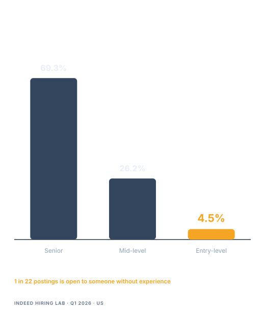
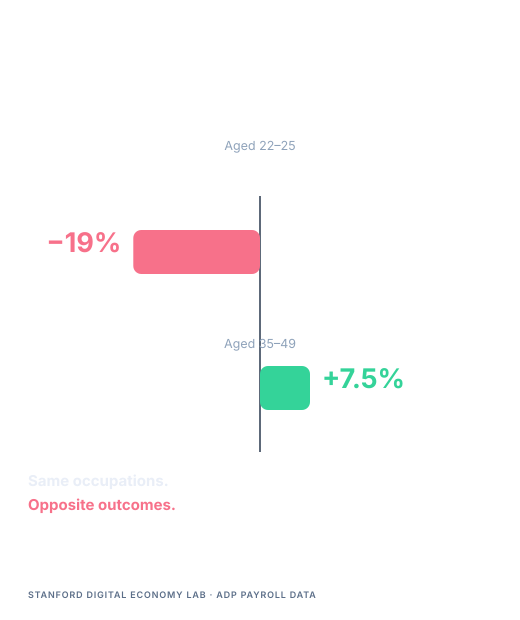
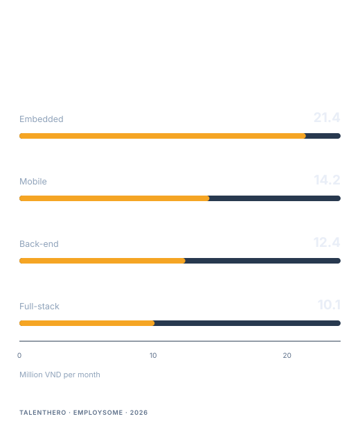
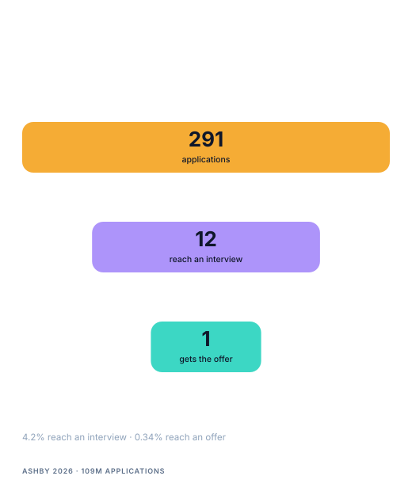
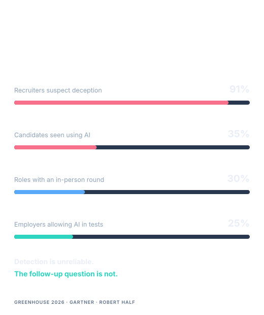
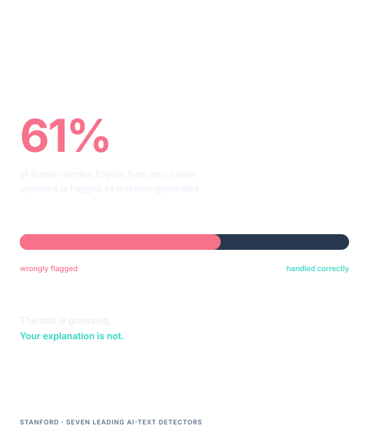
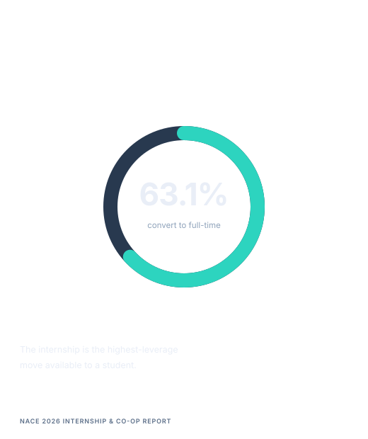
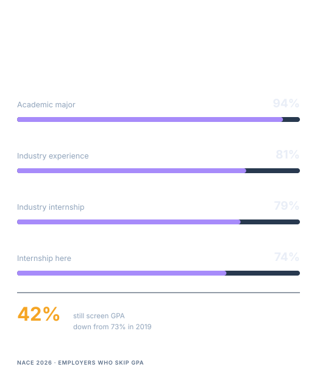
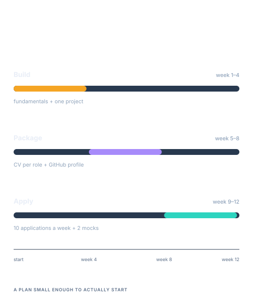

<!--markpress-opt
{
  "autoSplit": false,
  "sanitize": false,
  "title": "Student Hiring Preparation in the AI Era"
}
markpress-opt-->

<!--slide-attr x=0 y=0 scale=1.2 -->

# Student Hiring Preparation in the AI Era

## What Fresher and Intern hiring actually tests — and how to prepare from year 3 to first offer

Your Name · Tech Talk · 2026

<!-- SPEAKER NOTES — Slide 1 (~1 min)
[STORY: how this talk started — the moment you realised strong students were failing interviews for reasons nobody had told them about]

- Put the title up. Say nothing for two seconds. Let the room settle.
- Introduce yourself in one sentence: what you build, and how many freshers and interns you have interviewed or reviewed.
- Say the promise out loud: "By the end, you will know which of the eight things panels score you are currently failing."
-->

------

<!--slide-attr x=1300 y=-900 rotate=-2 scale=1.0 -->

# "I can code. My CV is clean."

**So why is nobody calling?**

<!-- SPEAKER NOTES — Slide 2 (~2 min)
- Read both lines and stop. This is the whole room's inner monologue.
- Ask for a show of hands: who has sent more than ten applications this semester? Who has had more than one interview? The gap between those two hands is the talk.
- [STORY: a specific student or candidate who said exactly this to you, and what was actually wrong]
- Frame it: the problem is almost never effort. It is that nobody showed them the rubric.
-->

------

<!--slide-attr x=2500 y=200 rotate=3 scale=1.0 -->

# Agenda

1. The hiring picture in the AI era
2. The process, and what panels actually score
3. The roadmap: year 3 to first offer
4. Q&A

<!-- SPEAKER NOTES — Slide 3 (~1 min)
- This is a map, not content. Do not explain each item.
- Set expectations: the first two sections are uncomfortable, the last one is the part you take home.
- Tell them Q&A is open at the end and that you prefer hard questions.
-->

------

<!--slide-attr x=2100 y=1700 rotate=-3 scale=1.0 -->

# Three things you have been told

| What you heard | What the data says |
|---|---|
| "ATS rejects 75% of CVs" | 92% of ATS rank candidates; they do not auto-reject |
| "Recruiters give you 6 seconds" | 7.4s is the first skim, not the decision |
| "AI killed junior jobs" | Entry-level share fell to 4.5%, not to zero |

**The number that actually matters:** 291 applications per hire.

<!-- SPEAKER NOTES — Slide 4 (~3 min)
- Start by earning credibility: you are going to remove advice they have been given that is simply wrong.
- "75% of resumes rejected by ATS" traces to a 2012 vendor quote with no published method. Enhancv interviewed 25 recruiters in 2025: 92% said their ATS does not auto-reject on content. It ranks.
- The 6-second number comes from a 2012 eye-tracking study of 30 recruiters. The 2018 follow-up measured 7.4 seconds for the initial skim only.
- "AI killed junior jobs" — the entry-level share of software postings fell to 4.5% in Q1 2026 in the US. That is catastrophic for a share, but it is not zero, and Vietnam's market is still growing.
- Land the real number: Ashby's data across 109 million applications shows 291 applications per hire. That is the game you are actually playing.
-->

------

<!--slide-attr x=600 y=2400 rotate=2 scale=1.0 -->

# One posting in 22

- Senior roles are **69.3%** of the market
- Entry-level fell **6.3%** while senior rose **13.5%**

<!-- SPEAKER NOTES — Slide 5 (~3 min)
- Source: Indeed Hiring Lab, Q1 2026. Senior roles are 69.3% of software postings; entry-level is 4.5%.
- Stanford's Digital Economy Lab study, "Canaries in the Coal Mine?", used ADP payroll records covering 3.5 to 5 million workers a month. Workers aged 22 to 25 in the most AI-exposed occupations are 19% below where they would be relative to less-exposed peers. Workers aged 35 to 49 in the same occupations grew 6 to 9%.
- Be careful and honest: this is US data, not Vietnam. Do not over-claim. The pattern is what matters, not the decimal.
- The point to leave in the room: the rung you are trying to step on is narrower than it was five years ago. That is a fact, not an insult.
-->

------

<!--slide-attr x=-1100 y=2100 rotate=-2 scale=1.05 -->

# The first rung got shorter

- AI writes **26.9%** of merged production code
- **45%** of AI-generated code ships an OWASP Top 10 flaw
- Developers were **19% slower** with AI, believing they were faster

**The work moved up. It did not move away.**

<!-- SPEAKER NOTES — Slide 6 (~3 min)
- This is the reframe of the whole talk. If they take one slide home, take this one.
- The tasks that used to train a junior — writing the boilerplate, wiring the form, fixing the simple bug — are now the tasks AI does first. What is left over is the part that requires judgment.
- 26.9% of merged production code is AI-generated by independent telemetry, not by vendor claims.
- Veracode 2025: 45% of AI-generated code samples introduced an OWASP Top 10 vulnerability. My own reviews agree: the code compiles, the code looks right, and the authorization check is missing.
- METR's 2025 randomized trial: experienced developers were 19% slower with AI while believing they were 20% faster. That gap between confidence and outcome is the new failure mode.
- [STORY: an AI-generated change you reviewed that looked correct and was not]
-->

------

<!--slide-attr x=-2200 y=900 rotate=3 scale=1.0 -->

# So the bar moved

## From "can you write this?" to "can you be trusted with a decision?"

- Decompose a problem you have never seen
- Explain the trade-off you chose
- Verify code you did not write
- Ask for help at the right moment

<!-- SPEAKER NOTES — Slide 7 (~3 min)
- Translate the reframe into skills they can practise this month. These four are the actual content of the interview.
- Decomposition: interviewers watch how you split an ambiguous requirement. Say your plan out loud before you type.
- Trade-offs: "I chose a database index here because reads dominate; the cost is slower writes" is worth more than a correct answer with no reasoning.
- Verification: this is the newest and least taught. Reviewing AI output is now a core junior skill.
- Asking for help: knowing when you are stuck for 40 minutes versus 4 hours is a scored behaviour, not a weakness.
-->

------

<!--slide-attr x=-2400 y=-700 rotate=-3 scale=1.0 -->

# Vietnam is not the same market

- **66.1%** of companies grew IT headcount in 2025
- **69.6%** plan to expand again in 2026
- Fresher pay: **10–14M VND** per month

**The bar is higher. The door is not closed.**

<!-- SPEAKER NOTES — Slide 8 (~2 min)
- Essential balance after the US data. ITviec's Vietnam IT Salary & Recruitment Market Report 2025-2026 surveyed 1,839 people across professionals, freelancers, students, HR leaders and executives.
- 66.1% of companies increased IT headcount in 2025, and 69.6% plan to expand in 2026. The market is growing, but selectively.
- 73% of companies have adopted AI, and it is shifting what they screen for: problem-solving, adaptability, collaboration. Not fewer people — different people.
- Salary context so nobody is guessing: back-end fresher around 12.4M VND, full-stack fresher around 10.1M, mobile fresher around 14.2M. Say the range, not the ceiling.
- The message: you are not fighting a closed market. You are fighting a higher bar in an open one.
-->

------

<!--slide-attr x=-1500 y=-2100 rotate=2 scale=1.0 -->

# The funnel, honestly

- **291** applications for every hire
- **3.6–4.7%** reach an interview
- **7.4 seconds** is the first CV skim
- **99.7%** of recruiters filter in the ATS

**You are not being judged. You are being sorted.**

<!-- SPEAKER NOTES — Slide 9 (~3 min)
- Walk the funnel from the company's side, because that is the view they have never seen.
- 291 applications per hire from Ashby's 2026 dataset of 109 million applications. Between 3.6% and 4.7% of applications reach an interview, down from 7 to 8% in 2021.
- The 7.4-second first skim is real but misunderstood: it decides whether you get the full read, not whether you get the job.
- 99.7% of recruiters use ATS filters — keyword match, title match, degree, certification.
- The honest framing: "sorted" is not cruelty, it is arithmetic. Your job is to be easy to sort upward.
-->

------

<!--slide-attr x=200 y=-2600 rotate=-2 scale=1.0 -->

# Your CV is not rejected. It is ranked.

- **92%** of ATS platforms never auto-reject on content
- Being **#150 of 180** is functionally a rejection
- **77%** of hiring managers call a typo an instant deal breaker
- **42%** of employers still screen GPA — down from **73%** in 2019

**One page. Numbers, not adjectives. Keywords that match the role.**

<!-- SPEAKER NOTES — Slide 10 (~4 min)
- This slide is where the audience relaxes, because it removes a fear and replaces it with an instruction.
- 92% of ATS platforms rank rather than reject (Enhancv 2025, 25 recruiters across 10+ platforms). But ranking 150th of 180 candidates is the same outcome as rejection. That is the trap.
- 77% of hiring managers call typos an instant deal breaker (CareerBuilder/Harris). Cheap to fix, expensive to ignore.
- GPA screening has dropped from 73% of employers in 2019 to 42% in 2026 (NACE). Skills-based hiring is now used by 70% of employers. This is the single most encouraging number in the deck for a student with a mediocre transcript.
- [STORY: the CV that got an interview despite a weak GPA, and why]
- Practical rules: one page for a fresher; every bullet ends in a number or a result; mirror the words in the job description; no skill listed that you cannot defend for five minutes.
-->

------

<!--slide-attr x=1900 y=-2000 rotate=3 scale=1.0 -->

# The eight boxes the panel fills in

- Problem decomposition
- Code quality
- CS fundamentals
- Communication
- Collaboration
- Coachability
- Ownership
- Motivation and domain fit

**You are scored on all eight. Most candidates prepare for two.**

<!-- SPEAKER NOTES — Slide 11 (~4 min)
- Show them the artifact. Every structured hiring process has a scorecard with competency rows and anchored levels.
- Walk each box with one observable signal:
  - Decomposition: can you split an ambiguous task into steps without being told.
  - Code quality: naming, error handling, structure — small programs still reveal it.
  - CS fundamentals: complexity, data structures, HTTP, database basics.
  - Communication: can you explain your own solution to someone who did not watch you write it.
  - Collaboration: how you behave when someone disagrees with you.
  - Coachability: what you do in the ten seconds after being told you are wrong.
  - Ownership: whether you finish things nobody is checking.
  - Motivation: whether you care about the domain or only about the job.
- The killer line: candidates over-prepare for fundamentals and code quality, and never practise collaboration or coachability. Those two are cheapest to improve and most often the reason for a no-hire.
-->

------

<!--slide-attr x=3300 y=-600 rotate=-3 scale=1.0 -->

# Some scores do not average out

> "A candidate can pass the total threshold and still be a no-hire."

**Knockout criteria usually include:**

- Honesty about what you built
- Ability to explain your own code
- Coachability under correction

<!-- SPEAKER NOTES — Slide 12 (~3 min)
- Explain the mechanics learned from structured hiring playbooks: teams define a minimum total score plus mandatory minimums on specific competencies. A candidate at 26 out of 40 with a 2 on coachability is a no-hire.
- This is the answer to "but I answered everything correctly". You can be right and still be rejected, for a reason outside the technical columns.
- Honesty is a knockout because it is unrecoverable. One invented project and the panel stops trusting every other line on the CV.
- [STORY: a strong technical candidate rejected on a knockout criterion, and what the debrief sounded like]
-->

------

<!--slide-attr x=3900 y=1200 rotate=2 scale=1.0 -->

# The reasons you get cut

- You cannot explain a line of your own project
- You blame your teammate, your lecturer, or the market
- The answer is memorized — the follow-up kills it
- Your portfolio link returns a 404
- You have no questions about the team
- You claim a skill you cannot demonstrate

<!-- SPEAKER NOTES — Slide 13 (~4 min)
- Read these fast and let them land. No explanation needed for most.
- The first one is the most common and the most fatal: a candidate lists a project, then cannot say why a specific function is written that way. It converts a strength into evidence of fabrication.
- Broken portfolio links are self-inflicted. A junior will be asked to check their own work; failing that check before you are hired is a strong signal.
- "No questions about the team" reads as low motivation. Have three questions ready, none of them about salary or leave.
- [STORY: the most common rejection reason you have written in a debrief]
-->

------

<!--slide-attr x=3000 y=2700 rotate=-2 scale=1.0 -->

# AI is allowed. Not being able to explain it is not.

- **35%** of interviews show candidates using AI
- **91%** of recruiters suspect deception
- In-person rounds: **5%** of roles → **30%**
- **>25%** of employers now allow AI in technical tests

<!-- SPEAKER NOTES — Slide 14 (~4 min)
- Correct a widespread misunderstanding: companies are not trying to ban AI. They are trying to find out whether you can work without it when it fails.
- Greenhouse 2026: recruiters observed candidates using AI during interviews in 35% of cases, and 91% have spotted or suspected deception. 63% saw AI-inflated resume claims, 48% fake references.
- The industry response was structural: in-person rounds went from about 5% of roles in 2024 to about 30% in 2025, and 72.4% of recruiting leaders now run at least one in-person interview.
- At the same time, more than 25% of employers allow AI in technical interviews, heading toward 50% — Canva, Rippling, Red Hat, Meta, Shopify openly permit it.
- Why the follow-up question is the real exam: it is the cheapest test that survives any tool. "Why did you choose this over that?" cannot be delegated to a model that is not in the room.
-->

------

<!--slide-attr x=1400 y=3500 rotate=3 scale=1.0 -->

# Detection is unreliable, and it is not neutral

- Human-written, non-native English flagged as AI: **61%**
- The detector is guessing. Your explanation is not
- If you cannot rebuild it, do not submit it

**Do not hide your AI use. Make every line explainable.**

<!-- SPEAKER NOTES — Slide 15 (~3 min)
- This is the slide that matters most for this room, and it is the one they will not hear anywhere else.
- Stanford researchers found seven leading AI-text detectors wrongly flagged non-native English writing as machine-generated 61% of the time. If you write English as a second language, a detector is more likely to be wrong about you than right.
- So the strategy of hiding is both unreliable and unnecessary. Companies know you use AI. What they cannot tolerate is work you cannot defend.
- Practical instruction: keep your prompts, keep your commits, be able to reproduce your own result from scratch. If you cannot rebuild it, do not submit it.
- This is also the professional habit that will outlast this talk: provenance. Know what you generated, what you changed, and why.
-->

------

<!--slide-attr x=-600 y=3600 rotate=-3 scale=1.0 -->

# Year 3 — build what you will be tested on

- Fundamentals: data structures, complexity, Git, SQL, HTTP
- One project you deploy and keep alive for a year
- Read code you did not write
- Apply for your first internship now

<!-- SPEAKER NOTES — Slide 16 (~4 min)
- Shift tone here. The first half was diagnosis; the second half is prescription. Be concrete and dated.
- Fundamentals are not optional because AI writes code: the interview still tests them, and the panel still scores them.
- One project, deployed, kept alive. Three tutorial clones with no README prove nothing. A deployed app that connects to a real API and handles authentication proves two things at once: you can ship, and you can solve a real problem.
- Reading code you did not write is the skill AI made most valuable and universities teach least.
- The internship is the highest-leverage move available: NACE's 2026 report puts average intern-to-full-time conversion at 63.1%. Nothing else on this list has that hit rate.
-->

------

<!--slide-attr x=-2500 y=3000 rotate=2 scale=1.0 -->

# Year 4 — convert ability into evidence

- Get the internship. It is the highest-leverage move available
- Three mock interviews before the real one
- One CV per role, not one CV for everything
- Make the internship line the strongest on the page

<!-- SPEAKER NOTES — Slide 17 (~4 min)
- Year 4 is not about learning more. It is about converting what you know into things a stranger can verify.
- NACE: when GPA is not the screen, the top factors are academic major (94%), industry experience (81%), industry internships (79%), internship with the hiring company (74%). Internships are doing the work that a transcript used to do.
- Mock interviews: three minimum, one with a stranger. The skill being tested is fluency under observation, which is built by repetition, not by reading about it.
- One CV per role: mirroring the job description is not dishonesty, it is translation. The same experience, described in the employer's vocabulary.
-->

------

<!--slide-attr x=-3900 y=1600 rotate=-2 scale=1.0 -->

# New grad — run the pipeline, not the panic

- Apply in batches, track every application
- Ask for referrals before you ask for jobs
- Prepare three stories you can tell in 90 seconds
- Evaluate offers on learning, not only salary

<!-- SPEAKER NOTES — Slide 18 (~3 min)
- The post-graduation phase has a different failure mode: random, emotional application instead of a managed pipeline.
- Batches and tracking turn rejection into data. If 100 applications produce zero interviews, the CV is the problem. If interviews produce zero offers, the interview is the problem. You cannot tell which without records.
- Referrals: a referral moves your application out of the 291 and into a shortlist. Ask classmates who interned, ask alumni, ask in communities. Most students never ask.
- Three stories in 90 seconds: a project you shipped, a bug you fixed under pressure, a disagreement you resolved. These cover most behavioural questions.
- Offers: at this stage, the learning curve compounds faster than a 2M VND difference.
-->

------

<!--slide-attr x=-4300 y=-400 rotate=3 scale=1.0 -->

# The evidence stack

| Artifact | What it proves |
|---|---|
| CV | You can summarize yourself for a 7-second skim |
| GitHub | The code exists, and it is yours |
| One deployed project | You can ship, not just follow a tutorial |
| A README with decisions | You can explain a trade-off |
| Internship or referral | Someone trusted you with real work |

<!-- SPEAKER NOTES — Slide 19 (~4 min)
- This is the take-home artifact of the talk. Five things, each proving something different. Most candidates have one and a half.
- CV proves summarization. GitHub proves existence and authorship. A deployed project proves shipping. A README with decisions proves judgment. An internship or referral proves someone trusted you.
- Point out the gap they can close tonight: add a "Decisions" section to the README of their best project. Problem, options considered, choice, cost. It takes 30 minutes and it is the highest-value writing they will do this semester.
- AI-era addendum: document your process. Which parts you generated, which you changed, and how you verified. That is what a Tech Lead wants to see in a review, and it is the same skill they are hiring for.
-->

------

<!--slide-attr x=-3500 y=-2100 rotate=-3 scale=1.0 -->

# The next 12 weeks

- Start with deployment in week 1, not week 12
- Track every application — the pattern tells you what to fix

**Twelve weeks of boring repetition beats twelve months of planning.**

<!-- SPEAKER NOTES — Slide 20 (~3 min)
- Convert the talk into a calendar they can start on Monday. This is the slide people photograph.
- Weeks 1 to 4: pick one project you actually want, deploy it in week 2, not week 12. Deployment early forces the boring parts to surface while you still have time.
- Weeks 5 to 8: one CV per role means rewriting the top third, not the whole document. GitHub profile: pinned repos, READMEs, no empty repositories from 2022.
- Weeks 9 to 12: ten applications a week and two mock interviews. Volume with tracking, not volume with hope.
- Close the loop: this plan is not ambitious, and that is the point. It is small enough that they might actually do it.
-->

------

<!--slide-attr x=-1800 y=-3300 scale=1.2 -->

# Questions

| GitHub | Website |
|---|---|
|  |  |
|  |  |

<!-- SPEAKER NOTES — Slide 21 (~25 min)
- Leave this up for the whole Q&A so people can scan the QR codes while you answer.
- Seed the first question if the room is shy: "What is the one thing you would fix on a fresher CV in 30 seconds?"
- Keep answers to 90 seconds. If a question deserves longer, offer to continue after the session.
- Have these ready: which companies actually hire freshers in Vietnam; whether a bootcamp is worth it; how to handle a low GPA; whether to learn AI or fundamentals first; how to answer "why should we hire you".
-->
