<!--markpress-opt
{
  "autoSplit": false,
  "sanitize": false,
  "title": "Chuẩn bị cho sinh viên IT thời AI"
}
markpress-opt-->

<!--slide-attr x=0 y=0 scale=1.2 -->

# Chuẩn bị cho sinh viên IT thời AI

## Nhà tuyển dụng Fresher/Intern thực sự đánh giá điều gì — và chuẩn bị thế nào từ năm 3 đến khi có việc đầu tiên

Tên bạn · Tech Talk · 2026

<!-- SPEAKER NOTES — Slide 1 (~1 phút)
[STORY: vì sao bạn mở talk này — khoảnh khắc bạn nhận ra những sinh viên giỏi vẫn trượt phỏng vấn vì lý do chẳng ai nói cho họ biết]

- Đưa tiêu đề lên. Im lặng hai giây. Để khán phòng ổn định.
- Giới thiệu một câu: bạn làm gì, đã phỏng vấn hay đọc hồ sơ của bao nhiêu fresher và intern.
- Nói rõ lời hứa: "Hết buổi hôm nay, các bạn sẽ biết mình đang trượt ở những ô nào trong tám ô mà hội đồng chấm."
-->

------

<!--slide-attr x=1300 y=-900 rotate=-2 scale=1.0 -->

# "Em biết code. CV em cũng đẹp."

**Vậy tại sao không ai gọi?**

<!-- SPEAKER NOTES — Slide 2 (~2 phút)
- Đọc cả hai dòng rồi dừng. Đây chính là độc thoại trong đầu của cả khán phòng.
- Giơ tay: ai đã nộp hơn mười chỗ học kỳ này? Ai đã có hơn một buổi phỏng vấn? Khoảng cách giữa hai bàn tay đó là toàn bộ nội dung của buổi nói chuyện.
- [STORY: một bạn cụ thể từng nói đúng câu này với bạn, và vấn đề thật sự nằm ở đâu]
- Định khung: vấn đề gần như không bao giờ là thiếu nỗ lực. Vấn đề là chưa ai chỉ cho họ cái thang điểm.
-->

------

<!--slide-attr x=2500 y=200 rotate=3 scale=1.0 -->

# Nội dung

1. Bức tranh tuyển dụng trong thời đại AI
2. Quy trình và những gì hội đồng thực sự chấm
3. Lộ trình: từ năm 3 đến công việc đầu tiên
4. Hỏi đáp

<!-- SPEAKER NOTES — Slide 3 (~1 phút)
- Đây là bản đồ, không phải nội dung. Đừng giải thích từng mục.
- Đặt kỳ vọng: hai phần đầu hơi khó nghe, phần cuối là phần mang về nhà được.
- Nói rõ phần hỏi đáp ở cuối, và bạn thích câu hỏi khó.
-->

------

<!--slide-attr x=2100 y=1700 rotate=-3 scale=1.0 -->

# Ba điều các bạn từng được nghe

| Điều bạn nghe | Dữ liệu nói gì |
|---|---|
| "ATS loại 75% CV" | 92% hệ thống ATS xếp hạng, không tự loại |
| "Nhà tuyển dụng chỉ xem 6 giây" | 7,4 giây là lần lướt đầu, không phải lúc quyết định |
| "AI giết hết việc của junior" | Tỷ lệ tin tuyển entry-level giảm còn 4,5%, không phải về 0 |

**Con số thực sự quan trọng:** 291 hồ sơ cho một vị trí được tuyển.

<!-- SPEAKER NOTES — Slide 4 (~3 phút)
- Mở đầu bằng việc giành uy tín: bạn sẽ gỡ bỏ vài lời khuyên họ từng được nghe mà đơn giản là sai.
- "75% CV bị ATS loại" bắt nguồn từ một câu nói của nhà cung cấp năm 2012, không có phương pháp công bố. Enhancv phỏng vấn 25 recruiter năm 2025: 92% nói ATS của họ không tự loại theo nội dung, mà xếp hạng.
- Con số 6 giây đến từ nghiên cứu eye-tracking năm 2012 trên 30 recruiter. Bản 2018 đo 7,4 giây cho lần lướt đầu tiên.
- "AI giết việc junior": tỷ lệ tin tuyển entry-level trong ngành phần mềm ở Mỹ quý 1/2026 còn 4,5%. Thảm khốc cho một tỷ lệ, nhưng không phải bằng không, và thị trường Việt Nam vẫn đang tăng.
- Chốt bằng con số thật: dữ liệu Ashby trên 109 triệu hồ sơ cho thấy 291 ứng viên cho một vị trí được tuyển. Đó mới là cuộc chơi thật.
-->

------

<!--slide-attr x=600 y=2400 rotate=2 scale=1.0 -->

# Một tin tuyển trong 22

- Vị trí senior chiếm **69,3%** thị trường
- Entry-level giảm **6,3%** trong khi senior tăng **13,5%**

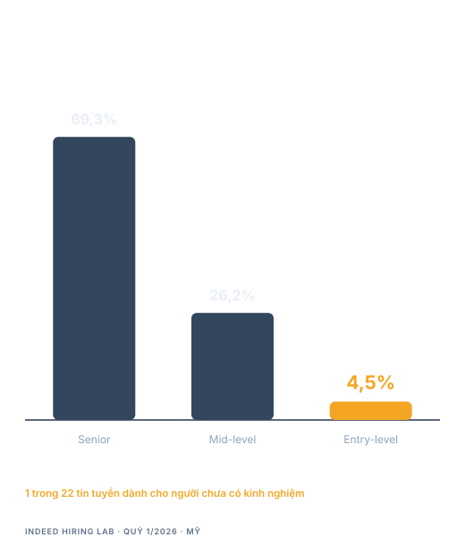

<!-- SPEAKER NOTES — Slide 5 (~3 phút)
- Nguồn: Indeed Hiring Lab, quý 1/2026. Vị trí senior chiếm 69,3% tin tuyển phần mềm; entry-level còn 4,5%.
- Nghiên cứu "Canaries in the Coal Mine?" của Stanford Digital Economy Lab dùng dữ liệu bảng lương ADP, 3,5 đến 5 triệu lao động mỗi tháng. Nhóm 22 đến 25 tuổi trong ngành chịu ảnh hưởng AI mạnh nhất thấp hơn 19% so với nhóm ít chịu ảnh hưởng. Nhóm 35 đến 49 tuổi cùng ngành lại tăng 6 đến 9%.
- Trung thực và cẩn thận: đây là dữ liệu Mỹ, không phải Việt Nam. Đừng nói quá. Xu hướng mới là điều quan trọng, không phải chữ số thập phân.
- Điều cần đọng lại: bậc thang đầu tiên hẹp hơn năm năm trước. Đó là sự thật, không phải lời chê.
-->

------

<!--slide-attr x=-1100 y=2100 rotate=-2 scale=1.05 -->

# Bậc thang đầu tiên ngắn lại

- AI viết **26,9%** code đã merge vào production
- **45%** code do AI sinh ra mắc lỗi OWASP Top 10
- Lập trình viên **chậm hơn 19%** khi dùng AI mà tưởng mình nhanh hơn

**Công việc dịch lên trên. Nó không biến mất.**

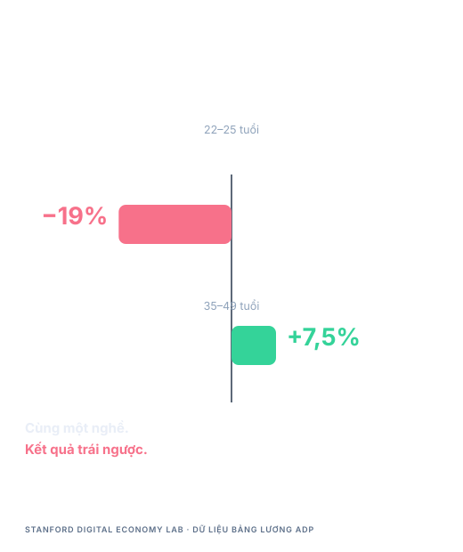

<!-- SPEAKER NOTES — Slide 6 (~3 phút)
- Đây là slide định khung lại toàn bộ buổi nói chuyện. Nếu chỉ mang về một slide, hãy mang slide này.
- Những việc từng dùng để đào tạo junior — viết boilerplate, nối form, sửa bug đơn giản — giờ là việc AI làm trước. Phần còn lại là phần cần phán đoán.
- 26,9% code production đã merge là do AI sinh ra, theo đo lường độc lập chứ không phải lời quảng cáo.
- Veracode 2025: 45% mẫu code do AI sinh ra mắc lỗ hổng OWASP Top 10. Kinh nghiệm review của tôi cũng vậy: code biên dịch được, trông đúng, và thiếu phần kiểm tra phân quyền.
- Thử nghiệm ngẫu nhiên của METR năm 2025: lập trình viên có kinh nghiệm chậm hơn 19% khi dùng AI nhưng tin mình nhanh hơn 20%. Khoảng cách giữa tự tin và kết quả chính là kiểu thất bại mới.
- [STORY: một thay đổi do AI sinh ra bạn từng review, trông đúng mà không đúng]
-->

------

<!--slide-attr x=-2200 y=900 rotate=3 scale=1.0 -->

# Vậy nên tiêu chuẩn đã dịch

## Từ "viết được không?" sang "có đáng tin để giao một quyết định không?"

- Chia nhỏ một bài toán chưa từng gặp
- Giải thích đánh đổi bạn đã chọn
- Kiểm chứng code không phải do bạn viết
- Biết lúc nào nên nhờ giúp

<!-- SPEAKER NOTES — Slide 7 (~3 phút)
- Chuyển cách định khung thành kỹ năng họ luyện được ngay tháng này. Bốn điều này chính là nội dung thật của buổi phỏng vấn.
- Chia nhỏ: người phỏng vấn xem bạn tách một yêu cầu mơ hồ thành các bước thế nào. Nói kế hoạch thành tiếng trước khi gõ.
- Đánh đổi: "Em đánh index ở đây vì đọc nhiều hơn ghi, cái giá là ghi chậm hơn" đáng giá hơn một đáp án đúng mà không có lý do.
- Kiểm chứng: đây là kỹ năng mới nhất và ít được dạy nhất. Review đầu ra của AI giờ là kỹ năng lõi của junior.
- Nhờ giúp: biết mình kẹt 40 phút hay 4 tiếng là hành vi được chấm điểm, không phải điểm yếu.
-->

------

<!--slide-attr x=-2400 y=-700 rotate=-3 scale=1.0 -->

# Việt Nam không phải thị trường đó

- **66,1%** doanh nghiệp tăng nhân sự IT năm 2025
- **69,6%** dự định mở rộng tiếp trong 2026
- Lương fresher: **10–14 triệu VND** mỗi tháng

**Tiêu chuẩn cao hơn. Cửa không đóng.**

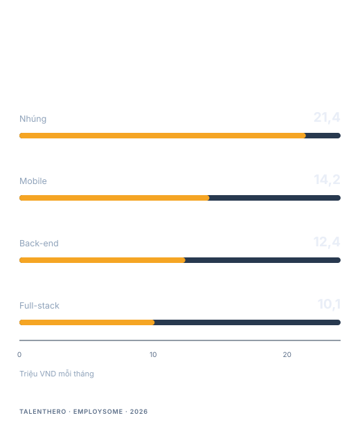

<!-- SPEAKER NOTES — Slide 8 (~2 phút)
- Cần cân bằng sau phần dữ liệu Mỹ. Báo cáo IT Salary & Recruitment Market 2025-2026 của ITviec khảo sát 1.839 người gồm nhân sự IT, freelancer, sinh viên, lãnh đạo HR và CxO.
- 66,1% doanh nghiệp tăng nhân sự IT trong 2025, và 69,6% dự định mở rộng trong 2026. Thị trường vẫn tăng, nhưng tăng có chọn lọc.
- 73% doanh nghiệp đã ứng dụng AI, và điều đó đang đổi thứ họ sàng lọc: giải quyết vấn đề, thích nghi, phối hợp. Không phải ít người hơn — mà là người khác đi.
- Nêu mức lương để không ai phải đoán: fresher back-end khoảng 12,4 triệu, full-stack khoảng 10,1 triệu, mobile khoảng 14,2 triệu. Nói khoảng, đừng nói mức trần.
- Thông điệp: các bạn không đang đánh nhau với một thị trường đóng. Các bạn đang đánh nhau với một tiêu chuẩn cao hơn trong một thị trường còn mở.
-->

------

<!--slide-attr x=-1500 y=-2100 rotate=2 scale=1.0 -->

# Phễu tuyển dụng, nói thẳng

- **291** hồ sơ cho mỗi vị trí được tuyển
- **3,6–4,7%** được gọi phỏng vấn
- **7,4 giây** cho lần lướt CV đầu tiên
- **99,7%** recruiter lọc bằng ATS

**Bạn không bị đánh giá. Bạn đang bị sắp xếp.**

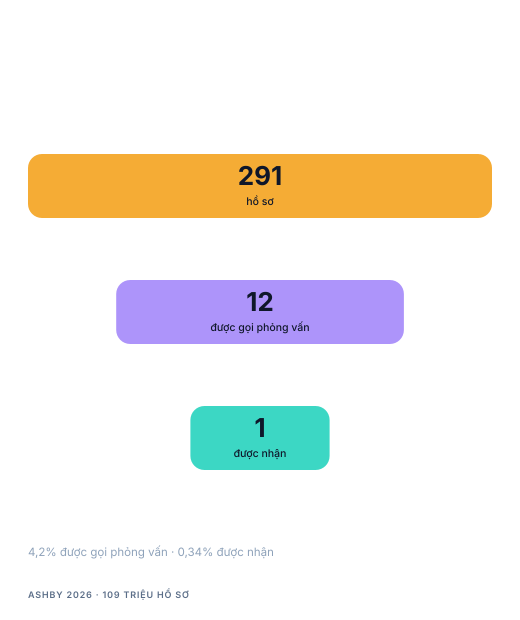

<!-- SPEAKER NOTES — Slide 9 (~3 phút)
- Đi qua phễu từ phía doanh nghiệp, vì đó là góc nhìn họ chưa từng thấy.
- 291 hồ sơ cho một vị trí được tuyển, từ dữ liệu 109 triệu hồ sơ của Ashby năm 2026. Từ 3,6% đến 4,7% hồ sơ được gọi phỏng vấn, giảm từ 7 đến 8% năm 2021.
- Con số 7,4 giây là thật nhưng bị hiểu sai: nó quyết định bạn có được đọc kỹ hay không, không quyết định bạn có được nhận hay không.
- 99,7% recruiter dùng bộ lọc trong ATS — khớp từ khóa, khớp chức danh, bằng cấp, chứng chỉ.
- Cách nói trung thực: "bị sắp xếp" không phải sự tàn nhẫn, đó là số học. Việc của bạn là làm cho mình dễ được xếp lên trên.
-->

------

<!--slide-attr x=200 y=-2600 rotate=-2 scale=1.0 -->

# CV của bạn không bị loại. Nó bị xếp hạng.

- **92%** nền tảng ATS không tự loại theo nội dung
- Đứng thứ **150/180** thì kết quả cũng như bị loại
- **77%** nhà tuyển dụng gọi lỗi chính tả là điểm loại tức thì
- **42%** doanh nghiệp còn lọc theo GPA — giảm từ **73%** năm 2019

**Một trang. Con số thay cho tính từ. Từ khóa khớp vị trí.**

<!-- SPEAKER NOTES — Slide 10 (~4 phút)
- Slide này làm khán phòng nhẹ đi, vì nó gỡ một nỗi sợ và thay bằng một chỉ dẫn.
- 92% nền tảng ATS xếp hạng chứ không loại (Enhancv 2025, 25 recruiter trên hơn 10 nền tảng). Nhưng đứng thứ 150 trong 180 ứng viên thì kết quả giống hệt bị loại. Cái bẫy nằm ở đó.
- 77% nhà tuyển dụng gọi lỗi chính tả là điểm loại tức thì (CareerBuilder/Harris). Sửa rất rẻ, bỏ qua rất đắt.
- Lọc theo GPA giảm từ 73% doanh nghiệp năm 2019 xuống 42% năm 2026 (NACE). 70% doanh nghiệp đang tuyển theo kỹ năng. Đây là con số khích lệ nhất trong cả bộ slide với một sinh viên có bảng điểm trung bình.
- [STORY: một CV vẫn được gọi phỏng vấn dù GPA thấp, và lý do]
- Nguyên tắc thực dụng: fresher thì một trang; mỗi gạch đầu dòng kết thúc bằng con số hoặc kết quả; dùng lại đúng từ trong mô tả công việc; không liệt kê kỹ năng nào bạn không bảo vệ được trong năm phút.
-->

------

<!--slide-attr x=1900 y=-2000 rotate=3 scale=1.0 -->

# Tám ô hội đồng thực sự điền

- Chia nhỏ vấn đề
- Chất lượng code
- Nền tảng khoa học máy tính
- Giao tiếp
- Phối hợp
- Khả năng tiếp thu hướng dẫn
- Tinh thần làm chủ
- Động lực và mức phù hợp với lĩnh vực

**Bạn được chấm cả tám ô. Phần lớn ứng viên chỉ chuẩn bị hai.**

<!-- SPEAKER NOTES — Slide 11 (~4 phút)
- Cho họ thấy vật thể thật. Mọi quy trình tuyển dụng có cấu trúc đều có một phiếu đánh giá với các hàng năng lực và mức mô tả rõ ràng.
- Đi qua từng ô với một dấu hiệu quan sát được:
  - Chia nhỏ vấn đề: có tách được một việc mơ hồ thành các bước mà không cần nhắc.
  - Chất lượng code: đặt tên, xử lý lỗi, cấu trúc — chương trình nhỏ vẫn lộ ra.
  - Nền tảng: độ phức tạp, cấu trúc dữ liệu, HTTP, kiến thức cơ sở dữ liệu.
  - Giao tiếp: có giải thích được lời giải của mình cho người không ngồi xem bạn gõ.
  - Phối hợp: bạn xử sự thế nào khi có người phản đối.
  - Tiếp thu hướng dẫn: bạn làm gì trong mười giây sau khi được nói mình sai.
  - Tinh thần làm chủ: có hoàn thành việc không ai kiểm tra không.
  - Động lực: quan tâm lĩnh vực hay chỉ quan tâm công việc.
- Câu chốt: ứng viên luyện quá nhiều nền tảng và chất lượng code, nhưng chưa từng luyện phối hợp hay tiếp thu hướng dẫn. Hai ô đó dễ cải thiện nhất và lại là lý do bị từ chối thường xuyên nhất.
-->

------

<!--slide-attr x=3300 y=-600 rotate=-3 scale=1.0 -->

# Có những điểm không cộng trung bình được

> "Một ứng viên có thể vượt ngưỡng tổng điểm và vẫn bị từ chối."

**Tiêu chí loại trực tiếp thường gồm:**

- Trung thực về những gì bạn làm
- Giải thích được code của chính mình
- Tiếp thu được khi bị sửa

<!-- SPEAKER NOTES — Slide 12 (~3 phút)
- Giải thích cơ chế từ các hướng dẫn tuyển dụng có cấu trúc: đội tuyển đặt một ngưỡng tổng điểm cộng với mức tối thiểu bắt buộc ở vài năng lực. Ứng viên 26/40 nhưng điểm tiếp thu hướng dẫn là 2 thì vẫn là không tuyển.
- Đây là câu trả lời cho "nhưng em trả lời đúng hết mà". Bạn có thể đúng và vẫn bị loại, vì một lý do nằm ngoài các cột kỹ thuật.
- Trung thực là tiêu chí loại trực tiếp vì không cứu được. Một dự án bịa ra là đủ để hội đồng ngừng tin mọi dòng còn lại trên CV.
- [STORY: một ứng viên mạnh về kỹ thuật bị loại vì tiêu chí trực tiếp, và biên bản họp đánh giá nói gì]
-->

------

<!--slide-attr x=3900 y=1200 rotate=2 scale=1.0 -->

# Những lý do bạn bị loại

- Không giải thích được một dòng trong chính dự án của mình
- Đổ lỗi cho bạn cùng nhóm, cho giảng viên, cho thị trường
- Câu trả lời học thuộc — hỏi lại là sập
- Link portfolio trả về 404
- Không có câu hỏi nào về đội ngũ
- Nhận mình biết một kỹ năng mà không chứng minh được

<!-- SPEAKER NOTES — Slide 13 (~4 phút)
- Đọc nhanh, để nó tự đọng lại. Phần lớn không cần giải thích.
- Lý do đầu tiên phổ biến nhất và chí mạng nhất: ứng viên liệt kê một dự án, rồi không nói được vì sao một hàm viết theo cách đó. Nó biến điểm mạnh thành bằng chứng của việc không trung thực.
- Link portfolio hỏng là tự bắn vào chân. Junior sẽ được giao tự kiểm tra việc của mình; trượt bài kiểm tra đó trước khi được nhận là tín hiệu rất mạnh.
- "Không có câu hỏi về đội ngũ" bị đọc là thiếu động lực. Chuẩn bị ba câu hỏi, không câu nào về lương hay nghỉ phép.
- [STORY: lý do từ chối phổ biến nhất bạn từng viết trong biên bản đánh giá]
-->

------

<!--slide-attr x=3000 y=2700 rotate=-2 scale=1.0 -->

# AI được phép. Không giải thích được mới là vấn đề.

- **35%** buổi phỏng vấn ghi nhận ứng viên dùng AI
- **91%** recruiter nghi ngờ ứng viên gian dối
- Vòng trực tiếp: **5%** vị trí → **30%**
- **Hơn 25%** doanh nghiệp cho phép dùng AI khi thi kỹ thuật

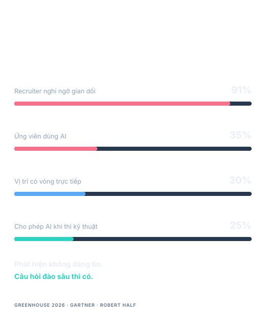

<!-- SPEAKER NOTES — Slide 14 (~4 phút)
- Sửa một hiểu nhầm phổ biến: doanh nghiệp không cố cấm AI. Họ cố tìm xem bạn có làm việc được khi AI sai hay không.
- Greenhouse 2026: recruiter ghi nhận ứng viên dùng AI khi phỏng vấn trong 35% trường hợp, và 91% từng phát hiện hoặc nghi ngờ gian dối. 63% gặp CV phóng đại bằng AI, 48% gặp người tham chiếu giả.
- Phản ứng của ngành là thay đổi cấu trúc: vòng trực tiếp tăng từ khoảng 5% vị trí năm 2024 lên khoảng 30% năm 2025, và 72,4% lãnh đạo tuyển dụng hiện có ít nhất một vòng trực tiếp.
- Đồng thời, hơn 25% doanh nghiệp cho phép dùng AI trong phỏng vấn kỹ thuật, dự kiến tiến tới 50% — Canva, Rippling, Red Hat, Meta, Shopify công khai cho phép.
- Vì sao câu hỏi đào sâu là bài kiểm tra thật: nó là phép thử rẻ nhất còn sống sót qua mọi công cụ. "Vì sao em chọn cách này thay vì cách kia?" không thể giao cho một mô hình không có mặt trong phòng.
-->

------

<!--slide-attr x=1400 y=3500 rotate=3 scale=1.0 -->

# Công cụ phát hiện không đáng tin, và không trung lập

- Văn bản người viết, tiếng Anh không bản ngữ, bị gắn nhãn AI: **61%**
- Công cụ đang đoán. Còn lời giải thích của bạn thì không
- Không dựng lại được thì đừng nộp

**Đừng giấu việc dùng AI. Hãy làm từng dòng giải thích được.**

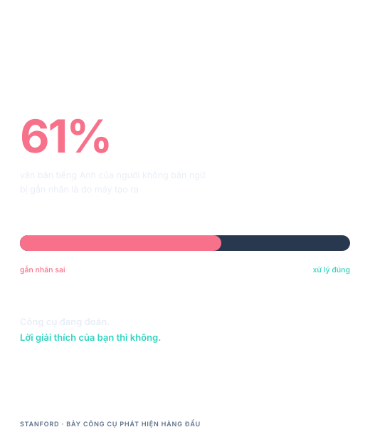

<!-- SPEAKER NOTES — Slide 15 (~3 phút)
- Đây là slide quan trọng nhất với khán phòng này, và là điều họ sẽ không nghe ở chỗ khác.
- Nghiên cứu Stanford cho thấy bảy công cụ phát hiện văn bản AI hàng đầu nhận nhầm văn bản tiếng Anh của người không bản ngữ là do máy tạo ra trong 61% trường hợp. Nếu bạn viết tiếng Anh như ngôn ngữ thứ hai, công cụ đó sai về bạn nhiều hơn đúng.
- Nên chiến lược giấu vừa không đáng tin vừa không cần thiết. Doanh nghiệp biết bạn dùng AI. Điều họ không chấp nhận được là phần việc bạn không bảo vệ được.
- Chỉ dẫn thực dụng: giữ prompt, giữ commit, có thể tái lập kết quả từ đầu. Nếu không dựng lại được, đừng nộp.
- Đây cũng là thói quen nghề nghiệp còn lại sau buổi nói chuyện này: nguồn gốc. Biết mình đã sinh ra gì, đã sửa gì, và vì sao.
-->

------

<!--slide-attr x=-600 y=3600 rotate=-3 scale=1.0 -->

# Năm 3 — xây đúng thứ sẽ bị kiểm tra

- Nền tảng: cấu trúc dữ liệu, độ phức tạp, Git, SQL, HTTP
- Một dự án được triển khai và duy trì suốt một năm
- Đọc code không phải do mình viết
- Nộp thực tập ngay từ bây giờ

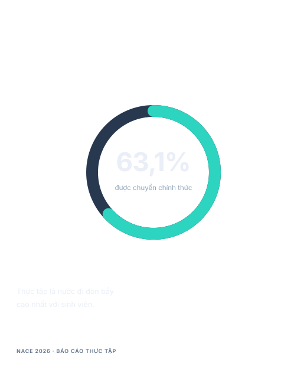

<!-- SPEAKER NOTES — Slide 16 (~4 phút)
- Đổi giọng ở đây. Nửa đầu là chẩn đoán, nửa sau là đơn thuốc. Cụ thể và có mốc thời gian.
- Nền tảng không phải thứ bỏ được vì AI viết code: phỏng vấn vẫn kiểm tra, hội đồng vẫn chấm.
- Một dự án, được triển khai, được duy trì. Ba bản clone tutorial không có README không chứng minh gì. Một ứng dụng đã deploy, nối API thật và có xác thực chứng minh hai điều cùng lúc: bạn ship được, và bạn giải được một vấn đề thật.
- Đọc code người khác viết là kỹ năng AI làm cho có giá nhất và trường học dạy ít nhất.
- Thực tập là nước đi đòn bẩy cao nhất: báo cáo NACE 2026 cho thấy tỷ lệ chuyển chính thức trung bình là 63,1%. Không mục nào khác trong danh sách có tỷ lệ đó.
-->

------

<!--slide-attr x=-2500 y=3000 rotate=2 scale=1.0 -->

# Năm 4 — biến năng lực thành bằng chứng

- Lấy được kỳ thực tập. Đây là nước đi đòn bẩy cao nhất
- Ba buổi phỏng vấn thử trước buổi thật
- Mỗi vị trí một CV, không dùng một CV cho tất cả
- Đưa dòng thực tập thành dòng mạnh nhất trên trang

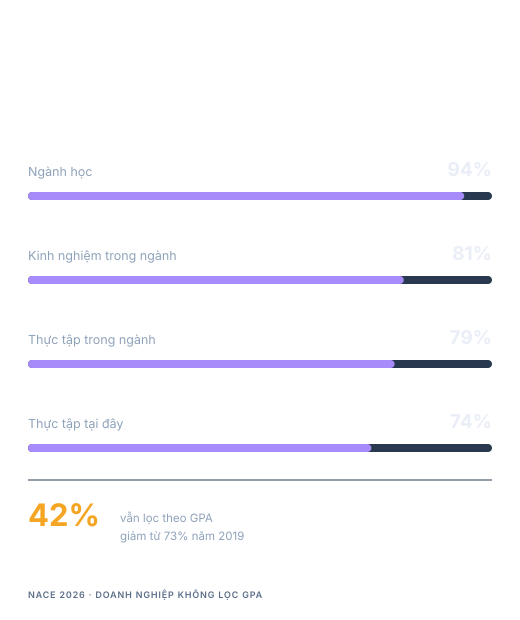

<!-- SPEAKER NOTES — Slide 17 (~4 phút)
- Năm 4 không phải học thêm. Nó là chuyển những gì bạn biết thành thứ người lạ kiểm chứng được.
- NACE: khi không lọc bằng GPA, các yếu tố hàng đầu là ngành học (94%), kinh nghiệm trong ngành (81%), thực tập trong ngành (79%), thực tập tại chính công ty tuyển (74%). Thực tập đang làm việc mà bảng điểm từng làm.
- Phỏng vấn thử: tối thiểu ba buổi, một buổi với người lạ. Kỹ năng bị kiểm tra là nói trôi chảy khi có người nhìn, thứ chỉ xây bằng lặp lại chứ không bằng đọc.
- Mỗi vị trí một CV: dùng lại từ của mô tả công việc không phải gian dối, đó là phiên dịch. Cùng một trải nghiệm, kể bằng từ vựng của nhà tuyển dụng.
-->

------

<!--slide-attr x=-3900 y=1600 rotate=-2 scale=1.0 -->

# Mới tốt nghiệp — chạy quy trình, đừng chạy theo hoảng loạn

- Nộp theo đợt, ghi lại từng hồ sơ
- Xin giới thiệu trước khi xin việc
- Chuẩn bị ba câu chuyện kể trong 90 giây
- Chọn offer theo mức học được, không chỉ theo lương

<!-- SPEAKER NOTES — Slide 18 (~3 phút)
- Giai đoạn sau tốt nghiệp có kiểu thất bại khác: nộp ngẫu hứng, cảm tính, thay vì quản lý như một quy trình.
- Nộp theo đợt và ghi chép biến việc bị từ chối thành dữ liệu. Nếu 100 hồ sơ không có buổi phỏng vấn nào, vấn đề ở CV. Nếu có phỏng vấn mà không có offer, vấn đề ở buổi phỏng vấn. Không ghi lại thì không phân biệt được.
- Giới thiệu: một lời giới thiệu đưa hồ sơ bạn ra khỏi nhóm 291 và vào danh sách rút gọn. Hỏi bạn cùng lớp từng thực tập, hỏi cựu sinh viên, hỏi trong cộng đồng. Phần lớn sinh viên không bao giờ hỏi.
- Ba câu chuyện trong 90 giây: một dự án bạn ship, một bug bạn sửa dưới áp lực, một bất đồng bạn hoá giải. Ba câu này phủ phần lớn câu hỏi hành vi.
- Offer: ở giai đoạn này, đường học dốc lên nhanh hơn chênh lệch 2 triệu đồng.
-->

------

<!--slide-attr x=-4300 y=-400 rotate=3 scale=1.0 -->

# Bộ bằng chứng

| Vật chứng | Nó chứng minh điều gì |
|---|---|
| CV | Bạn biết tóm tắt mình trong 7 giây lướt |
| GitHub | Code tồn tại, và là của bạn |
| Một dự án đã triển khai | Bạn ship được, không chỉ làm theo tutorial |
| README có phần quyết định | Bạn giải thích được một đánh đổi |
| Thực tập hoặc người giới thiệu | Ai đó đã tin bạn với việc thật |

<!-- SPEAKER NOTES — Slide 19 (~4 phút)
- Đây là phần mang về của buổi nói chuyện. Năm thứ, mỗi thứ chứng minh một điều khác nhau. Phần lớn ứng viên có một và một nửa.
- CV chứng minh khả năng tóm tắt. GitHub chứng minh sự tồn tại và tác giả. Dự án đã triển khai chứng minh ship được. README có phần quyết định chứng minh phán đoán. Thực tập hoặc người giới thiệu chứng minh ai đó đã tin bạn.
- Chỉ ra khoảng trống họ đóng được ngay tối nay: thêm mục "Quyết định" vào README của dự án tốt nhất. Vấn đề, các lựa chọn đã cân nhắc, lựa chọn cuối, cái giá. Mất 30 phút và là bài viết giá trị nhất họ làm trong học kỳ này.
- Ghi chú thời AI: ghi lại quá trình. Phần nào bạn sinh ra, phần nào bạn sửa, bạn kiểm chứng cách nào. Đó chính là thứ Tech Lead muốn thấy trong một buổi review, và cũng là kỹ năng họ đang tuyển.
-->

------

<!--slide-attr x=-3500 y=-2100 rotate=-3 scale=1.0 -->

# 12 tuần tới

- Triển khai dự án ngay tuần 1, không phải tuần 12
- Ghi lại từng hồ sơ — quy luật sẽ chỉ ra chỗ cần sửa

**Mười hai tuần lặp lại nhàm chán thắng mười hai tháng lập kế hoạch.**

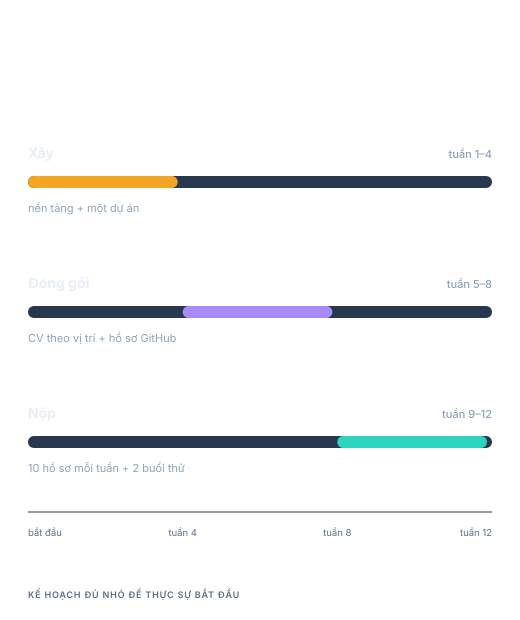

<!-- SPEAKER NOTES — Slide 20 (~3 phút)
- Biến buổi nói chuyện thành một lịch bắt đầu từ thứ Hai. Đây là slide người ta sẽ chụp lại.
- Tuần 1 đến 4: chọn một dự án bạn thật sự muốn làm, triển khai ở tuần 2 chứ không phải tuần 12. Triển khai sớm ép những phần nhàm chán lộ ra khi bạn còn thời gian.
- Tuần 5 đến 8: mỗi vị trí một CV nghĩa là viết lại một phần ba trên, không phải cả tài liệu. Hồ sơ GitHub: ghim repo, có README, không để repo rỗng từ 2022.
- Tuần 9 đến 12: mỗi tuần mười hồ sơ và hai buổi phỏng vấn thử. Nhiều nhưng có ghi chép, không phải nhiều và hy vọng.
- Khép lại: kế hoạch này không tham vọng, và đó chính là điểm mạnh. Nó nhỏ đủ để họ thật sự làm.
-->

------

<!--slide-attr x=-1800 y=-3300 scale=1.2 -->

# Hỏi đáp

| GitHub | Website |
|---|---|
| 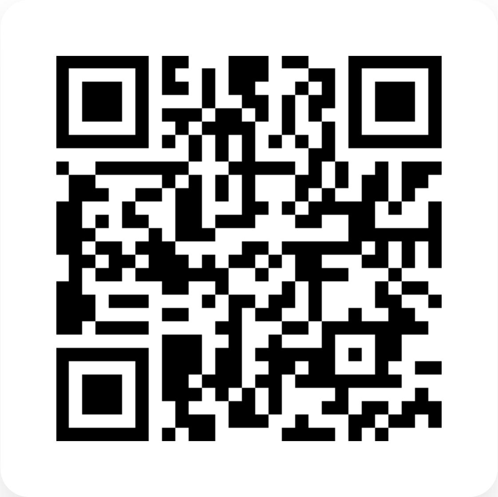 | 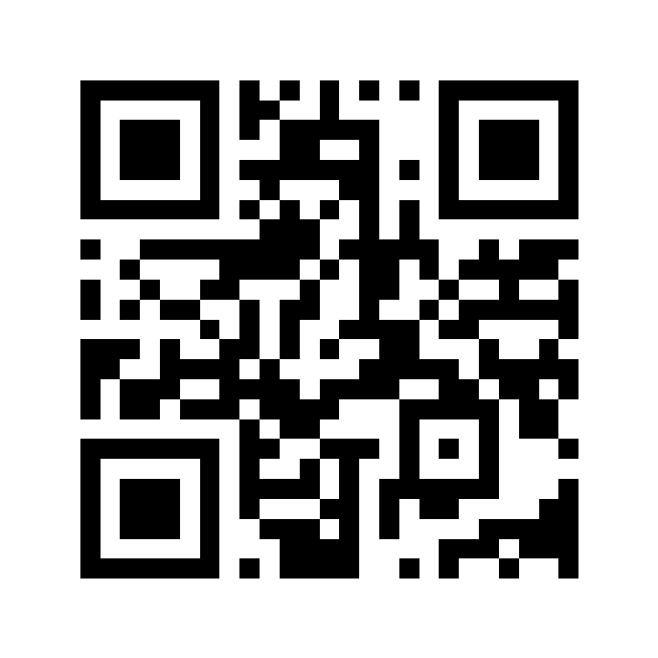 |
|  |  |

<!-- SPEAKER NOTES — Slide 21 (~25 phút)
- Để slide này suốt phần hỏi đáp để mọi người quét mã trong lúc bạn trả lời.
- Mồi câu hỏi đầu nếu khán phòng còn ngại: "Trong 30 giây, anh sẽ sửa điều gì đầu tiên trên CV của một fresher?"
- Giữ mỗi câu trả lời trong 90 giây. Nếu câu hỏi cần dài hơn, hẹn trao đổi sau buổi.
- Chuẩn bị sẵn: công ty nào ở Việt Nam thật sự tuyển fresher; bootcamp có đáng không; GPA thấp thì xử lý thế nào; nên học AI hay học nền tảng trước; trả lời "vì sao chúng tôi nên chọn em" thế nào.
-->
